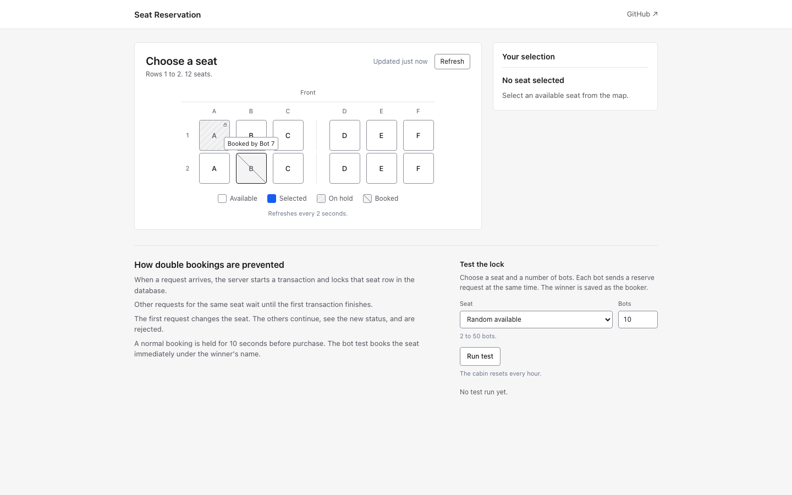
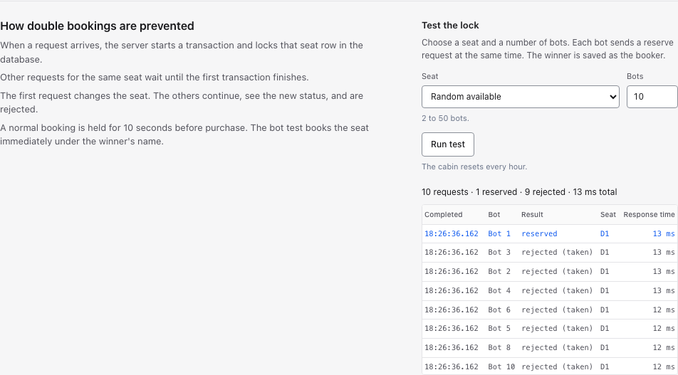
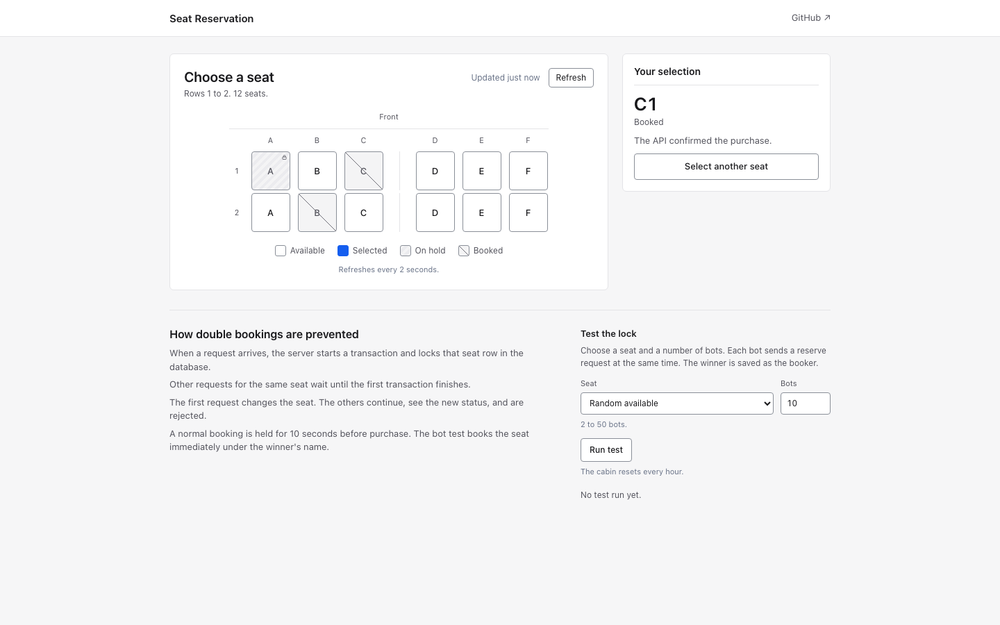
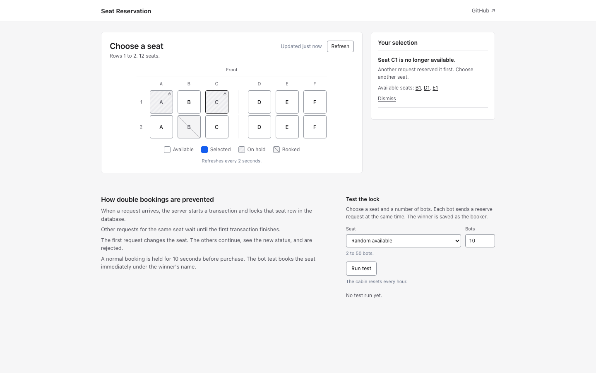
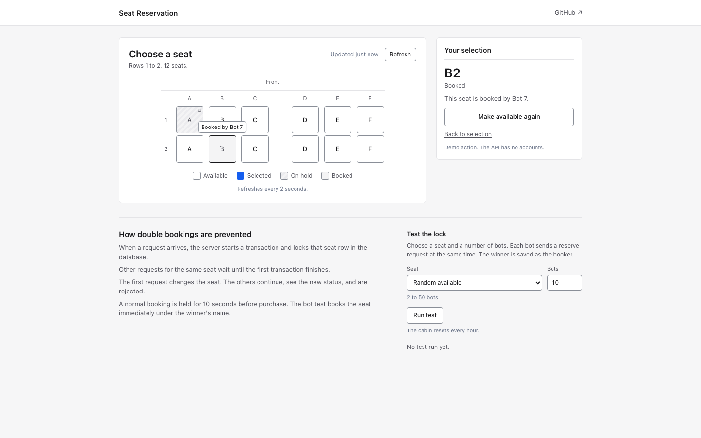

# Seat Reservation

**Live demo:** [seat-reservation-fullstack.vercel.app](https://seat-reservation-fullstack.vercel.app)  
**API:** [seat-backend-7ajo.onrender.com/seats](https://seat-backend-7ajo.onrender.com/seats)  
**Source:** [github.com/Ouscqr/seat-reservation-fullstack](https://github.com/Ouscqr/seat-reservation-fullstack)



A seat reservation demo. Pick a seat, hold it for 10 seconds, and confirm the
booking. The server uses PostgreSQL row locks so two requests cannot hold the
same seat.

The page also has a bot test. Choose a seat and 2 to 50 named bots, then send all
their reserve requests at once. The first request books the seat and stores the
winner's name in `bookedBy`; the rest are rejected. The request log below the
controls shows what happened, in the order the browser received the responses.

The API runs on Render's free plan and sleeps after inactivity. The app handles
that with a plain start-up state and keeps retrying. See [Cold starts](#cold-starts).

## The reservation flow

- Select an available seat. The server locks the row and the right panel shows
  the countdown.
- Confirm the booking to mark the seat booked, or release the seat.
- If the timer ends, the page releases the seat automatically.
- If another request wins the race, the panel says the seat is no longer
  available and lists nearby available seats.
- The map refreshes every 2 seconds and after every action.

## How double bookings are prevented

1. When a request arrives, the server starts a transaction and locks that seat
   row in the database.
2. Other requests for the same seat wait until the first transaction finishes.
3. The first request changes the seat. The others continue, see the new status,
   and are rejected.
4. A normal select holds the seat for 10 seconds. The bot test books it
   immediately and stores the winner in `bookedBy`.

The method is in
[`SeatService.reserveSeat()`](seat-backend/src/main/java/com/example/demo/SeatService.java):

```java
Seat seat = seatRepository
    .findByIdWithLock(seatId)
    .orElseThrow(() -> new SeatNotFoundException(seatId));

if (seat.getStatus() != SeatStatus.AVAILABLE) {
    return "This seat is taken";
}

if (bookedBy == null) {
    // A normal reservation holds the seat for 10 seconds.
    seat.setStatus(SeatStatus.LOCKED);
} else {
    // The bot test books it immediately and records the winner.
    seat.setStatus(SeatStatus.SOLD);
    seat.setBookedBy(bookedBy);
}
seatRepository.save(seat);
```

The timer runs in the browser and holds have no server-side expiry. The UI says
so. There are no accounts or payments in the demo.

## Test the lock

Choose a seat or let the page pick a random available one. Set 2 to 50 bots
(default 10) and run. Each bot sends
`POST /seats/{id}/reserve?by=Bot%20N` at the same time. The first request locks
the row, marks the seat SOLD, and stores `bookedBy`. The other bots see SOLD and
get "This seat is taken". The winning seat is not released.

The log shows the completion time, bot name, result, seat and response time.
Rows are ordered by the browser's response time, not by the server's lock order.
The winning row is in the accent colour. The summary above the log counts the
requests. The seat map tooltip and the side panel show who booked a seat.



The JUnit test `SeatConcurrencyTest` sends 12 concurrent named requests, checks
that exactly one succeeds, and checks that the stored `bookedBy` matches the
request that got the success response. A second test covers the hourly reset.

### The cabin reset

`CabinState` stores one `lastResetAt` timestamp in the database. There is no
scheduled job, because a sleeping Render instance would not run it. On any seat
request, if the timestamp is more than one hour old, a conditional update claims
the reset, sets every seat AVAILABLE and clears `bookedBy` in one transaction,
then the request continues. The conditional update means only one concurrent
request can perform the reset.

`GET /seats/status` returns `lastResetAt`, `nextResetAt` and the interval. When
no seats are available the page disables the test and shows the next reset time.

### Polling and the free tier

`GET /seats` polls every 2 seconds while the tab is visible. The Page Visibility
API stops the interval when the tab is hidden and refreshes once when it becomes
visible again. A visible tab still keeps Neon's compute awake; that is the trade
for a live 2 second map. The hidden pause and the lazy reset keep background work
down.

## Screenshots

| Seat hold with countdown | Booking confirmed |
| --- | --- |
|  |  |

| Seat taken by another request | Booked by a bot |
| --- | --- |
|  |  |

| Phone layout | Booking panel on a phone |
| --- | --- |
|  |  |

## Cold starts

The API sleeps on Render's free plan. A cold start can take up to a minute, so
the first request used to time out and the old frontend showed a network error
with an empty map. The current frontend waits for the server, shows a start-up
message, and retries automatically.


The API URL and CORS configuration are correct. A sleeping instance was the
cause of the empty live map. If the message does not clear after a minute, the
Render service may be down rather than starting.

## Stack

- React 19 and Vite, with CSS Modules. System fonts, no UI kit.
- Spring Boot 4 on Java 21, Spring Data JPA, H2 locally and PostgreSQL on Render.
- Frontend on Vercel, API on Render.

### API

| Method | Path | Purpose |
| --- | --- | --- |
| `GET` | `/seats` | All seats, including `bookedBy` |
| `GET` | `/seats/status` | Last reset, next reset and reset interval |
| `POST` | `/seats/{id}/reserve` | Lock an available seat for a 10 second hold |
| `POST` | `/seats/{id}/reserve?by=Bot%207` | Book immediately and store the named booker |
| `POST` | `/seats/{id}/release` | Free a locked seat |
| `POST` | `/seats/{id}/buy` | Turn a locked seat into a sale |
| `POST` | `/seats/{id}/sell` | Relist a sold seat |

`bookedBy` is null for normal holds and purchases. It is set only when a named
request takes the seat directly, which is what the bot test uses.

Every action returns HTTP 200 with a plain text body, including failures such as
"This seat is taken". A winning bot gets "Reserved by Bot 7". The frontend reads
those bodies instead of assuming a 200 means success. Unknown ids return 404
JSON.

The frontend polls `GET /seats` every 2 seconds while the tab is visible, never
overlaps requests, and refreshes immediately after every action. Polling stops
when the tab is hidden.

## Run locally

You need Java 21+ and Node 20+.

**Backend (port 8080)**

```bash
cd seat-backend
./mvnw spring-boot:run
```

The backend uses H2 and seeds 12 seats. Its startup `ConcurrencyTest` reserves
seat A1, so A1 normally shows as on hold. The live database may have more rows;
the map derives rows and columns from the API.

**Frontend (port 5173)**

```bash
cd seat-frontend
npm install
npm run dev
```

Open <http://localhost:5173>. To use another API, set
`VITE_API_URL=https://your-backend` in `seat-frontend/.env`.

## Verify

```bash
cd seat-backend && ./mvnw test
cd seat-frontend && npm ci && npm run lint && npm run build
```

The backend tests cover the named concurrent reserve and the lazy reset. The
interface was checked in Chromium at 1440px and 390px: reserve, hold, release,
expiry, booking, relisting, conflict handling, the bot test with 2 to 50 bots,
the ordered response log, `bookedBy` on the map and in the panel, the no-seat
reset time, polling pause and resume, cold start recovery, HTTP errors, empty
responses and keyboard navigation. axe-core reported no WCAG 2.1 A or AA
violations, and all 17 text and control colour pairs meet their contrast targets.

## Demo limits

- No accounts, payments or server-side hold expiry.
- Bot names are self-declared. Anyone can use any name.
- The cabin reset is lazy, so it happens on the next seat request after an hour
  with no reset.
- Free hosting cold starts.
- A visible tab polls every 2 seconds and keeps Neon's compute awake.
- The layout comes from the API, so the live database may show more rows than
  the local seed.

## Why I built it

To learn Spring Boot and deploy a full stack app with a real database, then make
the frontend show what the backend is doing.
