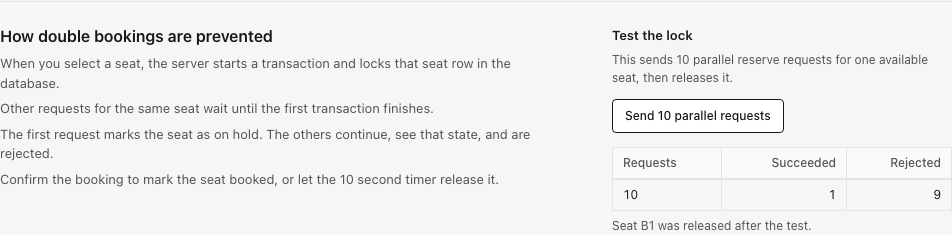
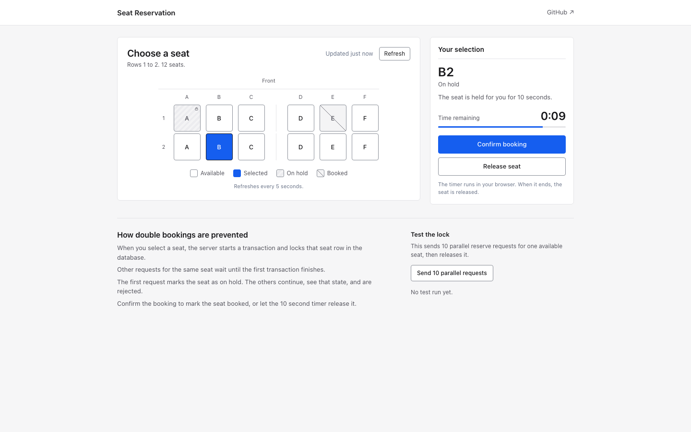
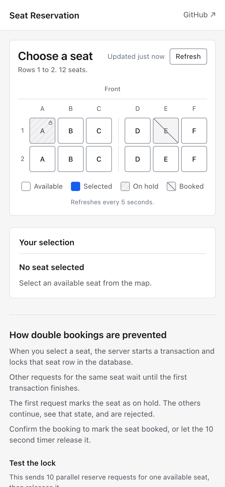
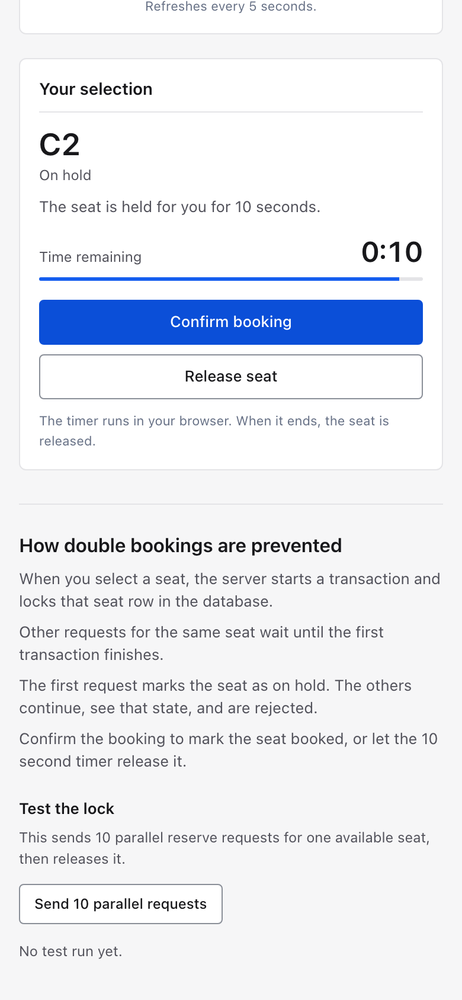
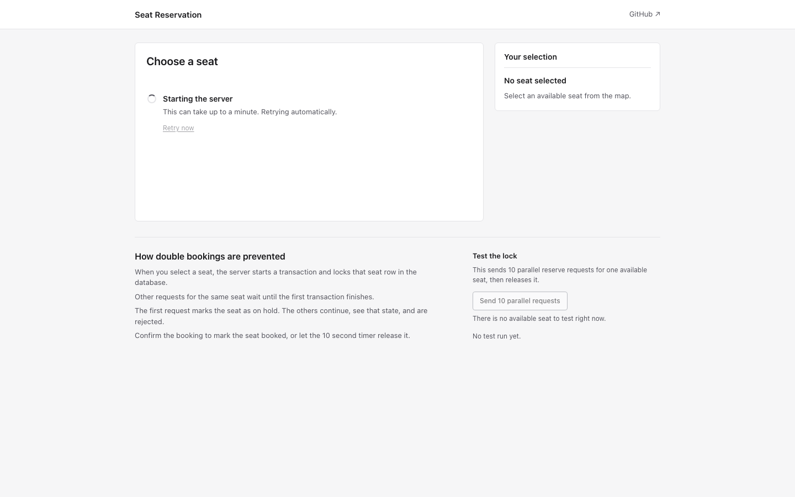

# Seat Reservation

**Live demo:** [seat-reservation-fullstack.vercel.app](https://seat-reservation-fullstack.vercel.app)  
**API:** [seat-backend-7ajo.onrender.com/seats](https://seat-backend-7ajo.onrender.com/seats)  
**Source:** [github.com/Ouscqr/seat-reservation-fullstack](https://github.com/Ouscqr/seat-reservation-fullstack)


A seat reservation demo. Pick a seat, hold it for 10 seconds, and confirm the
booking. The server uses PostgreSQL row locks so two requests cannot hold the
same seat.

The API runs on Render's free plan and sleeps after inactivity. The app handles
that with a plain start-up state and keeps retrying. See [Cold starts](#cold-starts).

## The reservation flow

- Select an available seat. The server locks the row and the right panel shows
  the countdown.
- Confirm the booking to mark the seat booked, or release the seat.
- If the timer ends, the page releases the seat automatically.
- If another request wins the race, the panel says the seat is no longer
  available and lists nearby available seats.
- The map refreshes every 5 seconds and after every action.

## How double bookings are prevented

1. When you select a seat, the server starts a transaction and locks that seat
   row in the database.
2. Other requests for the same seat wait until the first transaction finishes.
3. The first request marks the seat as on hold. The others continue, see that
   state, and are rejected.
4. Confirm the booking to mark the seat booked, or let the 10 second timer
   release it.

The method is in
[`SeatService.reserveSeat()`](seat-backend/src/main/java/com/example/demo/SeatService.java):

```java
Seat seat = seatRepository
    .findByIdWithLock(seatId)
    .orElseThrow(() ->
        new SeatNotFoundException(seatId));

if (seat.getStatus() != SeatStatus.AVAILABLE) {
    return "This seat is taken";
}

seat.setStatus(SeatStatus.LOCKED);
seatRepository.save(seat);
```

The timer runs in the browser and holds have no server-side expiry. The UI says
so. There are no accounts or payments in the demo.

## Test the lock

The page includes a button that sends 10 parallel reserve requests for one
available seat, then releases it. The result table shows how many requests
succeeded and how many were rejected.



## Screenshots

| Seat hold with countdown | Booking confirmed |
| --- | --- |
|  |  |

| Seat taken by another request | Phone layout |
| --- | --- |
|  |  |



## Cold starts

The API sleeps on Render's free plan. A cold start can take up to a minute, so
the first request used to time out and the old frontend showed a network error
with an empty map. The current frontend waits for the server, shows a start-up
message, and retries automatically.



The API URL and CORS configuration are correct. A sleeping instance was the
cause of the empty live map. If the message does not clear after a minute, the
Render service may be down rather than starting.

## Stack

- React 19 and Vite, with CSS Modules. System fonts, no UI kit.
- Spring Boot 4 on Java 21, Spring Data JPA, H2 locally and PostgreSQL on Render.
- Frontend on Vercel, API on Render.

### API

| Method | Path | Purpose |
| --- | --- | --- |
| `GET` | `/seats` | All seats, sorted by id |
| `POST` | `/seats/{id}/reserve` | Lock an available seat |
| `POST` | `/seats/{id}/release` | Free a locked seat |
| `POST` | `/seats/{id}/buy` | Turn a locked seat into a sale |
| `POST` | `/seats/{id}/sell` | Relist a sold seat |

Every action returns HTTP 200 with a plain text body, including failures such as
"This seat is taken". The frontend reads those bodies instead of assuming a 200
means success. Unknown ids return 404 JSON.

The frontend polls `GET /seats` every 5 seconds, never overlaps requests, and
refreshes immediately after every action.

## Run locally

You need Java 21+ and Node 20+.

**Backend (port 8080)**

```bash
cd seat-backend
./mvnw spring-boot:run
```

The backend uses H2 and seeds 12 seats. Its startup `ConcurrencyTest` reserves
seat A1, so A1 normally shows as on hold. The live database may have more rows;
the map derives rows and columns from the API.

**Frontend (port 5173)**

```bash
cd seat-frontend
npm install
npm run dev
```

Open <http://localhost:5173>. To use another API, set
`VITE_API_URL=https://your-backend` in `seat-frontend/.env`.

## Verify

```bash
cd seat-backend && ./mvnw test
cd seat-frontend && npm ci && npm run lint && npm run build
```

The interface was checked in Chromium at 1440px and 390px: reserve, hold,
release, expiry, booking, relisting, conflict handling, cold start recovery, HTTP
errors, empty responses, keyboard navigation and the 10 request test. axe-core
reported no WCAG 2.1 A or AA violations, and all 17 text and control colour pairs
meet their contrast targets.

## Demo limits

- No accounts, payments or server-side hold expiry.
- Anyone can release a hold or relist a booked seat.
- Free hosting cold starts.
- The layout comes from the API, so the live database may show more rows than
  the local seed.

## Why I built it

To learn Spring Boot and deploy a full stack app with a real database, then make
the frontend show what the backend is doing.
